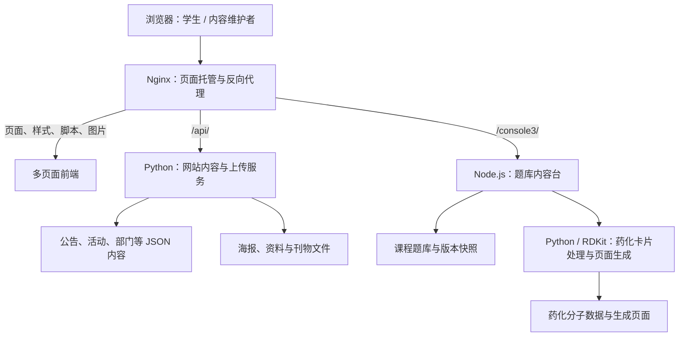

# 学习小站 · 药学院学促会

面向药学院学生的学习平台，将学院公告、活动信息、学习资料与药学课程练习集中在一个入口。网站提供药物分析、药剂学题库和药物化学分子记忆卡片，并配有网站内容台与题库内容台，供维护者更新内容。

[访问网站](http://123.206.117.192/) · [浏览公开学习资料](resources/README.md) · [部署与运维](docs/operations.md)

## 整体架构

网站采用**原生多页面前端 + Nginx + Python / Node.js 双后端服务**。前端由 HTML、CSS 和 JavaScript 组成，Nginx 直接提供页面与静态资源，同时将 API 请求转发给对应的本机服务。站点内容使用 JSON 文件保存，课程题库使用 JavaScript 数据文件保存。



Nginx 的反向代理负责把同一个网站地址下的不同请求转交给不同服务。两个后端均监听服务器本机地址，由 Nginx 统一提供外部访问入口。

## 功能与模块

| 模块 | 主要功能 | 代码位置 |
| --- | --- | --- |
| 网站门户 | 首页、公告、活动详情、资料检索、部门介绍与加入入口 | `web/*.html`、`web/assets/app.js` |
| 网站内容台 | 编辑站点信息、公告、活动、部门和资料，上传海报及文件 | `web/console.html`、`web/assets/console.js` |
| 网站内容服务 | 读取和保存站点 JSON 内容，接收图片、资料及刊物上传 | `services/upload/server.py` |
| 课程练习 | 药分、药剂课程题目练习，以及药化分子背诵 | `web/yaofen/`、`web/yaoji/`、`web/yaohua/` |
| 题库内容台 | 编辑题目和药化卡片、发布更新、保存快照及回滚 | `services/console/` |
| 代码部署 | 拉取主分支、校验代码、更新文件、健康检查与失败回滚 | `deploy/` |
| 公开资料 | 当前学习文档、题库、卡片数据和配图的导出快照 | `resources/` |

两个内容台承担不同的工作：网站内容台管理公告和资料等门户内容；题库内容台管理课程题目和分子卡片。

## 请求与数据流

### 网站内容

页面启动后，`app.js` 请求 `GET /api/data`，取得服务器上的公告、活动、资料目录和站点设置。读取失败时使用代码内置的示例数据。维护者在网站内容台保存修改时，通过 `POST /api/data` 写回 JSON；上传接口将文件保存到对应目录，并返回供页面引用的地址。

| 外部接口 | 用途 | 后端 |
| --- | --- | --- |
| `GET /api/data` | 获取公开站点内容 | Python，默认本机端口 `8788` |
| `POST /api/data` | 保存站点内容，要求管理口令 | Python |
| `POST /api/upload` | 上传海报图片 | Python |
| `POST /api/upload-doc` | 上传学习资料 | Python |
| `POST /api/upload-issue` | 更新刊物图片 | Python |
| `GET /api/health` | 查询内容服务状态 | Python |

### 题库与药化卡片

药分、药剂页面加载各自的 `data_*.js` 题库文件。题库内容台经 `/console3/` 访问 Node.js 服务：发布操作校验并写入数据，生成内容台启动数据，同时保存版本快照。药化卡片处理会调用 Python / RDKit，页面生成脚本将源模板、分子数据和图片打包为线上页面。学习工具的本地练习记录由浏览器存储，与服务器上的题库内容分开管理。

题库后台的路由经 Nginx 去掉 `/console3/` 前缀后转发，例如外部的 `/console3/api/publish` 对应 Node.js 内部的 `/api/publish`。状态、版本列表、快照和回滚接口也使用这个入口。

## 技术组成

| 层次 | 技术 | 作用 |
| --- | --- | --- |
| 前端 | HTML、CSS、原生 JavaScript | 页面、内容渲染、管理界面与课程练习 |
| 网站入口 | Nginx | 静态文件托管、缓存策略、后台访问控制与反向代理 |
| 内容后端 | Python 标准库 HTTP 服务 | JSON 内容读写与文件上传 |
| 题库后端 | Node.js 原生 HTTP、文件系统与子进程模块 | 题库发布、校验、快照与回滚 |
| 药化处理 | Python、RDKit | 分子结构处理与药化页面生成 |
| 持久化 | JSON、JavaScript 数据文件、上传目录 | 保存站点内容、题库和附件 |
| 进程管理 | systemd | 后台服务运行与定时部署 |

当前前端无需框架打包即可部署。后端通过文件系统保存业务数据，现有业务代码未使用关系型数据库。

## 仓库结构

```text
.
├── web/                    # 网站页面、样式、浏览器脚本与静态资源
│   ├── assets/
│   ├── yaofen/             # 药物分析练习页面
│   ├── yaoji/              # 药剂学练习页面
│   └── yaohua/             # 药化工具资源；线上入口由后台生成
├── services/
│   ├── upload/             # Python 网站内容与文件上传服务
│   └── console/            # Node.js 题库内容台、药化源模板与处理脚本
├── resources/              # 当前公开资料快照，含文件校验清单
├── deploy/                 # 代码同步脚本、systemd 单元与部署测试
└── docs/                   # 部署和运维说明
```

## 代码、运行数据与资料快照

`web/`、`services/` 保存应用代码。服务器上的内容 JSON、上传附件、题库数据、内容台快照和生成页面由后台维护，代码部署会保护这些运行数据，避免用仓库文件覆盖内容台的新修改。

`resources/` 是供公开阅读和下载的资料快照。修改这个目录不会直接修改线上题库；内容台后续产生的变化也不会自动回写该目录。仓库未收录私钥、真实管理口令、宝塔面板数据库或完整服务器状态，因此克隆仓库后仍需配置后端环境和运行数据，才能复现完整线上服务。

## 协作与上线

贡献者通过 **Fork → 修改 → Pull Request → 维护者审核合并** 提交改动。服务器上的 systemd 定时任务每 60 秒检查 `main`，取得新提交后执行语法校验、更新受管理的代码并进行健康检查，失败时恢复本次代码变更。实际延迟还取决于网络和检查耗时。

部署入口、数据路径、认证配置及运维命令见[部署与运维说明](docs/operations.md)。
